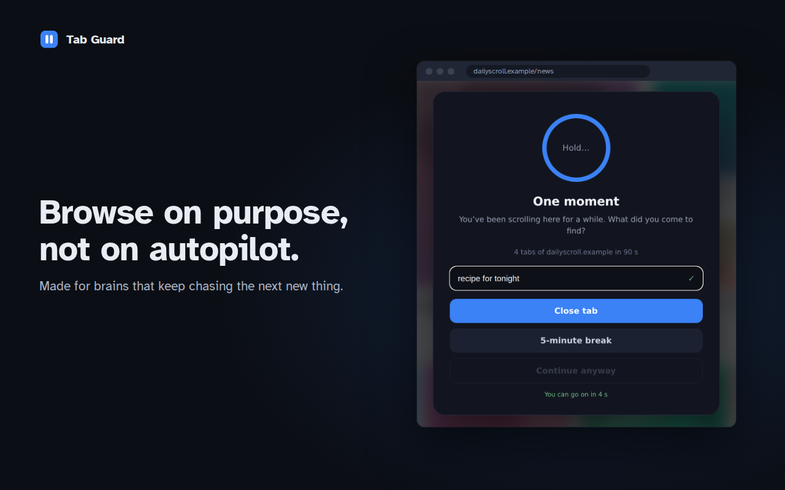

  

<h1 align="center">Tab Guard</h1>

  <b>Surf mit Absicht, nicht auf Autopilot.</b> 
  Eine Browser-Erweiterung gegen Doomscrolling und zwanghaftes Tab-Hopping. 
  Nur lokal · ohne Konto · ohne Tracking · kostenlos

<a href="README.md">English</a>

  

Tab Guard greift ein, wenn Surfen zum Autopiloten wird: der fünfte Tab derselben Seite, der Feed ohne Ende, das „nur noch ein Video“. Es stoppt dich mit einer bewussten Pause und einer Frage, macht Seiten reizärmer, je länger du bleibst, und sperrt, was du gar nicht sehen willst. Auf Seiten, denen du vertraust, hält es sich raus.

Für Köpfe, die ständig den nächsten Reiz suchen.

## Was es macht

- **Feed zu Reibung:** Nach einer Seite eines Endlos-Feeds warten weitere Beiträge hinter einem Button mit kurzem Countdown.
- **Tab-Schutzschalter:** Vier Tabs derselben Seite in 90 Sekunden lösen eine Atempause aus, sieben in fünf Minuten sperren die Seite für 30 Minuten. Danach landest du genau dort, wo du hinwolltest.
- **Atempause und Absicht:** ein Atemzug, dann eine Frage: Was hast du hier vor? Ein klares Wort reicht.
- **Eskalationsleiter:** Je länger du auf beobachteten Seiten hängen bleibst, desto grauer und unschärfer werden Bilder, bis hin zur Sperre. Der Druck lässt von selbst nach.
- **Short-Form-Filter:** blendet Hochkant-Kurzvideos aus oder verwischt sie, auch in eingebetteten Playern, ebenso `/shorts/`- und `/reels/`-Seiten. Querformat-Videos bleiben unberührt.
- **Vorschau-Videos:** stoppt Hover-Vorschauen und hält animierte GIFs beim ersten Bild an.
- **Jugendschutz:** erkennt Adult-Seiten an ihrem Inhalt, sperrt sie und erzwingt SafeSearch bei Google, Bing, DuckDuckGo, Brave, Yahoo und SearXNG.
- **Blockliste, Import, Weiterleitungen:** eigene Blockliste, importierte Listen (z. B. aus Cold Turkey) und Weiterleitungen wie reddit.com → eine ruhigere Oberfläche.
- **Notausgänge mit kleinem Preis:** Pausieren und Zurücksetzen warten jedes Mal etwas länger, mit einem Tagesbudget, das du festlegst.
- **Nie gesperrt:** Hilfe-, Gesundheits- und Behördenseiten werden nie gesperrt oder gebremst. Einmal am Tag gibt es 20 Minuten Notfallzugang zu einer gesperrten Seite.

### Erkennt von selbst, was dich reinzieht

Nicht alles hängt an einer Blockliste. Jede Seite, die du nicht als vertraut markiert hast, gilt als *beobachtet*, und Tab Guard erkennt Endlos-Feeds, Kurzvideos und Adult-Seiten an dem, was auf der Seite ist. So fallen neue Seiten oder Umwege um deine Blockliste oft trotzdem auf.

### Regeln, die du festlegst und die halten

Du bestimmst, was vertraut, beobachtet oder gesperrt ist. Arbeit, Fachsuche und die Streamingdienste, die du auswählst, bleiben unberührt.

- **Lockern wartet eine Stunde.** Ausschalten, mehr Budget oder eine Seite von der Blockliste nehmen greift erst eine Stunde nach dem Speichern. Verschärfungen gelten sofort.
- **Einstellungssperre.** Auf Wunsch musst du vorher einen angezeigten Code von Hand abtippen (Einfügen geht nicht).
- **Pause-Button.** Schaltet die Bremsen eine Weile ab. Blockliste, Jugendschutz und Weiterleitungen bleiben aktiv.

## Privat von Grund auf

Kein Konto, kein Server, keine Statistik. Einstellungen, Listen und Zähler bleiben im lokalen Speicher deines Browsers. Die Erweiterung stellt keine eigenen Netzwerkanfragen. Details: [Datenschutzerklärung](tab-guard-PRIVACY.md#deutsch).

## Installieren

Die Einträge im Chrome Web Store und bei Firefox Add-ons sind unterwegs. Bis dahin, oder für den neuesten Stand:

**Chrome, Brave, Edge, Opera**
1. Repository herunterladen oder klonen.
2. `chrome://extensions` öffnen (Brave: `brave://extensions`) und den **Entwicklermodus** einschalten.
3. **Entpackte Erweiterung laden** und den Ordner `extension` wählen.

**Firefox** (vorübergehend, bis zum nächsten Neustart)
1. `scripts/build.sh` ausführen.
2. `about:debugging#/runtime/this-firefox` öffnen, **Temporäres Add-on laden…** und `dist/tab-guard_vX.Y.Z-firefox.zip` wählen.

## Sprachen

Englisch, Deutsch, Französisch, Spanisch, Rumänisch. Die Sprache folgt deinem Browser und lässt sich in den Einstellungen ändern.

## Entwicklung, Lizenz

Aufbau, Build und Lint stehen im [englischen README](README.md#development). Lizenz: [MIT](LICENSE).
