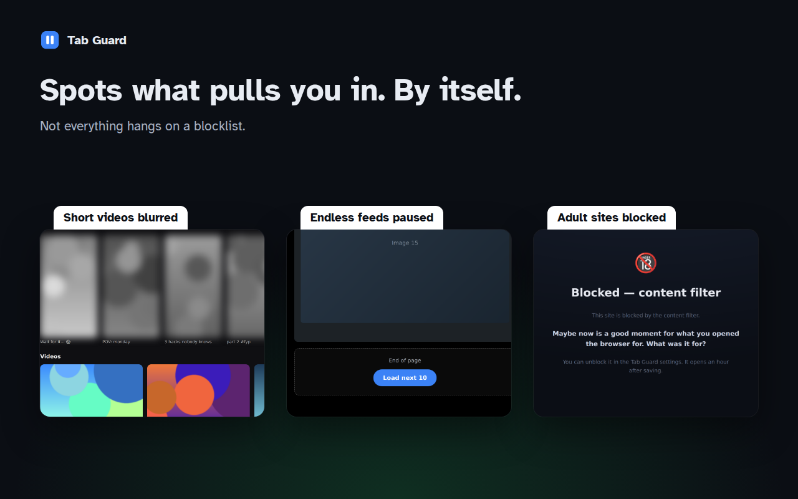
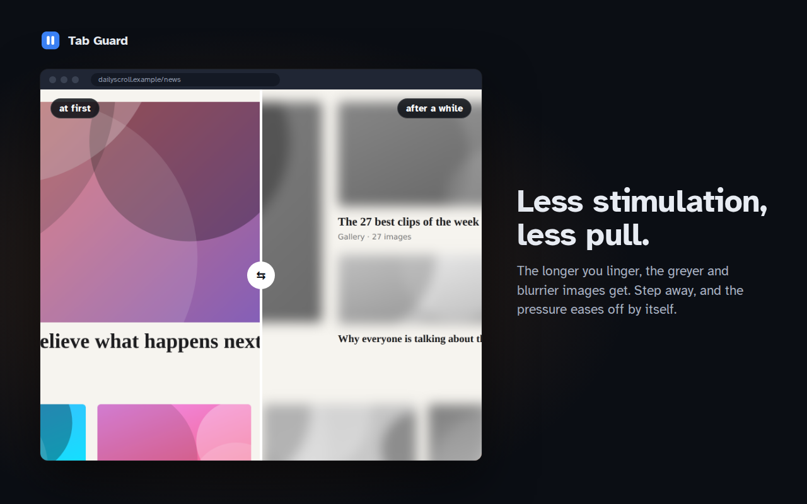
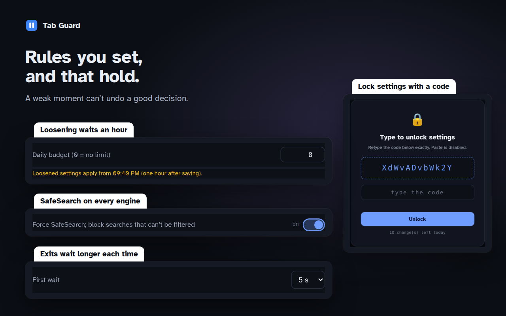
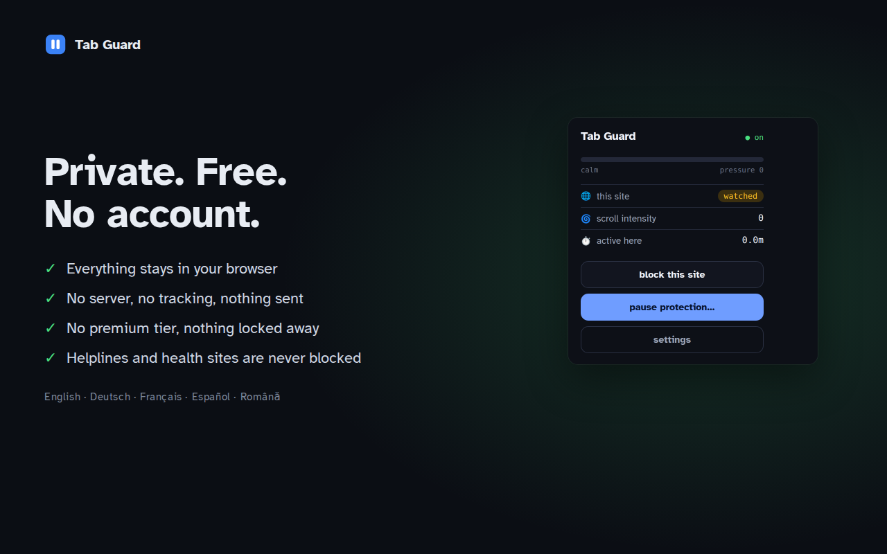

<p align="center">
  
</p>

<h1 align="center">Tab Guard</h1>

<p align="center">
  <b>Browse on purpose, not on autopilot.</b><br>
  A browser extension against doomscrolling and compulsive tab-hopping.<br>
  Local only · no account · no tracking · free
</p>

<p align="center">
  <a href="LICENSE"></a>
  
  
  <a href="README.de.md"></a>
</p>

<p align="center">
  
</p>

Tab Guard notices when browsing slips into autopilot: the fifth tab of the same site, the feed that never ends, the "just one more video". It stops you with a deliberate pause and one question, makes pages less stimulating the longer you stay, and blocks what you don't want to see at all. On the sites you trust, it stays out of the way.

Made for brains that keep chasing the next new thing.

## What it does

| | |
|---|---|
| **Feed to friction** | After one page of an endless feed, new posts wait behind a button with a short countdown. |
| **Tab circuit breaker** | Four tabs of one site in 90 seconds trigger a breathing pause; seven in five minutes lock the site for 30 minutes. When the lock ends, you land where you were going. |
| **Breathing pause + intention** | One breath, then one question: what are you here for? One clear word is enough. |
| **Escalation ladder** | The longer you linger on watched sites, the greyer and blurrier images get, up to a block. The pressure eases off by itself. |
| **Short-form filter** | Hides or blurs vertical short videos, also inside embedded players, and `/shorts/` or `/reels/` pages. Landscape videos stay untouched. |
| **Calm view** | Grey or blur all pictures from the popup, with exceptions per site. Hover a moment to see one. |
| **Video previews** | Stops hover-preview clips and freezes animated GIFs on their first frame. |
| **Content filter** | Recognises adult sites by what's on the page, blocks them, and enforces SafeSearch on Google, Bing, DuckDuckGo, Brave, Yahoo and SearXNG. Proxy and unblocked-games sites are recognised by how they are built and closed; on YouTube, guides for getting around filters are hidden. |
| **Blocklist, import, redirects** | Your own blocklist, imported lists (e.g. from Cold Turkey), and redirects such as reddit.com → a calmer front end. |
| **Exits that cost a little** | Pausing or resetting waits a bit longer each time, with a daily budget you set. |
| **Never blocked** | Helplines, health and government sites are never blocked or slowed. Once a day there's 20 minutes of emergency access to a blocked site. |

### Spots what pulls you in, by itself

Not everything hangs on a blocklist. Every site you haven't marked as trusted counts as *watched*, and Tab Guard recognises endless feeds, short videos and adult sites by what is on the page. A new site, or a way around your blocklist, often gets caught anyway.

<p align="center">
  
  
</p>

### Rules you set, and that hold

You decide what is trusted, watched or blocked. Work, academic search and the streaming services you choose are left alone.

- **Loosening waits an hour.** Switching something off, raising a budget or removing a blocked site takes effect one hour after saving. Tightening applies at once. A weak moment can't undo a good decision.
- **Settings lock.** Optionally, you have to type a shown code by hand (no pasting) before you change anything.
- **Pause button.** Switches the friction off for a while. Blocklist, content filter and redirects stay on.

<p align="center">
  
  
</p>

## Private by design

No account, no server, no analytics. Settings, lists and counters stay in your browser's local storage. The extension makes no network requests of its own. Details: [privacy policy](tab-guard-PRIVACY.md).

## Touch Grass (optional, experimental)

Tab Guard stands on its own. For people who also use [Touch Grass](https://github.com/coach-kg/touchgrass-mac), the blocker that unlocks once you have been outside, there is a hidden switch under **Settings → Experimental → Connect with Touch Grass**. With it, the Touch Grass Mac app can require Tab Guard in every browser and close browsers that run without it.

Switching it on asks for the optional `nativeMessaging` permission. Tab Guard then tells the Mac app every few seconds that it is running, how many windows it sees and whether it may run in private windows. Nothing else, and nothing leaves the computer. Without the switch none of this code runs. Code: [`extension/src/touchGrass.js`](extension/src/touchGrass.js).

Touch Grass: [for Mac](https://github.com/coach-kg/touchgrass-mac) · [for Android](https://github.com/coach-kg/TouchGrassBlocker)

## Install

Store listings for the Chrome Web Store and Firefox Add-ons are on their way. Until then, or to run the latest code:

**Chrome, Brave, Edge, Opera**
1. Download or clone this repository.
2. Open `chrome://extensions` (Brave: `brave://extensions`) and turn on **Developer mode**.
3. Click **Load unpacked** and pick the `extension` folder.

**Firefox** (temporary, until the next restart)
1. Run `scripts/build.sh` (see below).
2. Open `about:debugging#/runtime/this-firefox`, click **Load Temporary Add-on…** and pick `dist/tab-guard_vX.Y.Z-firefox.zip`.

## Languages

English, Deutsch, Français, Español, Română. The language follows your browser and can be changed in the settings.

## Development

There is no framework and no bundler: plain JavaScript, HTML and CSS, Manifest V3.

```
extension/
  manifest.json       Chrome manifest (the Firefox one is derived from it)
  background.js       service worker: pressure, tab circuit breaker, blocking, exits
  content/            content scripts: overlays, feed and video handling, block screens
  src/                shared logic (short-form classification, adult signals, import, loosening …)
  popup/  options/    toolbar popup and settings page
  pages/              block, wait and redirect pages
  assets/             icons, fonts, translations (i18n.js)
  _locales/           store name and description per language
docs/                 screenshots, store texts, permission notes
scripts/build.sh      builds the Chrome and Firefox packages into dist/
```

**Build**

```sh
scripts/build.sh            # → dist/tab-guard_vX.Y.Z-chrome.zip and -firefox.zip
```

The Firefox package gets `browser_specific_settings` and a non-service-worker background. Its add-on ID comes from the `GECKO_ID` environment variable or a local, untracked `.gecko-id` file.

**Lint**

```sh
npx addons-linter dist/tab-guard_v*-firefox.zip
```

The one expected warning is the dynamic `import()` in `content/content.js`: it loads the extension's own modules through `chrome.runtime.getURL()`, since content scripts can't be ES modules.

Changes are listed in the [changelog](CHANGELOG.md). Ideas and bug reports are welcome, see [contributing](CONTRIBUTING.md).

## License

[MIT](LICENSE), provided as is, without warranty. You use it at your own risk. Helplines, health and government sites are never blocked. The bundled Atkinson Hyperlegible font is under the [SIL Open Font License](extension/assets/fonts/OFL.txt).
