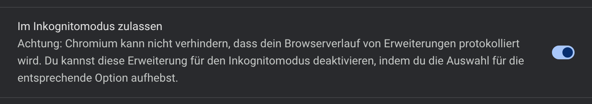
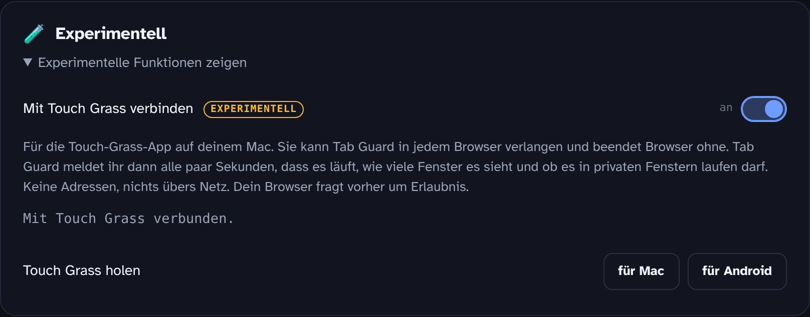
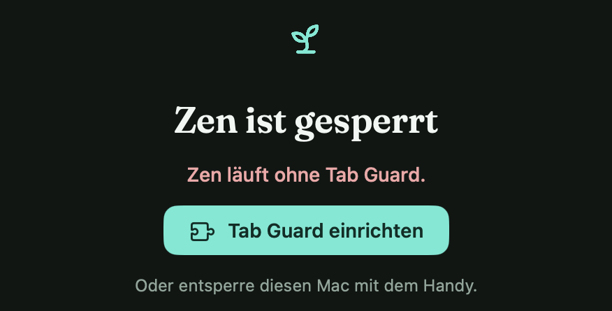

  

<h1 align="center">Tab Guard mit Touch Grass verbinden</h1>

  
  &nbsp;
  

<a href="touch-grass.md">English</a>

[Touch Grass für Mac](https://github.com/coach-kg/touchgrass-mac) kann Tab Guard in jedem Browser verlangen. Browser ohne Tab Guard werden nach 10 Sekunden beendet. Diese vier Schritte verbinden beides. Einmal in jedem Browser, den du nutzt.

## 1. Tab Guard hinzufügen

| Browser | Wo |
|---|---|
| Chrome, Brave, Arc, Vivaldi | [Chrome Web Store](https://chromewebstore.google.com/detail/tab-guard/imjfddpobokjecegpoghmojaondepmai) |
| Edge, Opera | [Chrome Web Store](https://chromewebstore.google.com/detail/tab-guard/imjfddpobokjecegpoghmojaondepmai). Oben auf der Store-Seite erscheint ein Balken: Erweiterungen aus anderen Stores einmal zulassen, dann Tab Guard hinzufügen. |
| Firefox, Zen | [Firefox Add-ons](https://addons.mozilla.org/de/firefox/addon/tab-guard/) |

In Safari läuft Tab Guard nicht. Touch Grass beendet Safari, solange die Browser-Regel an ist.

## 2. In privaten Fenstern erlauben

Touch Grass beendet einen Browser, wenn dort ein privates Fenster ohne Tab Guard aufgehen könnte.

**Chrome, Brave, Edge, Opera:** `chrome://extensions` öffnen (Brave: `brave://extensions`, Edge: `edge://extensions`). Tab Guard → **Details** → **Im Inkognitomodus zulassen** einschalten.

  

**Firefox, Zen:** Beim Hinzufügen **Ausführung dieser Erweiterung in privaten Fenstern erlauben** ankreuzen. Verpasst? `about:addons` öffnen → Tab Guard → **In privaten Fenstern ausführen** → **Erlauben**.

## 3. In Tab Guard die Verbindung einschalten

1. Die Einstellungen von Tab Guard öffnen. Rechtsklick auf das Tab-Guard-Symbol → **Optionen** (Firefox: **Erweiterung verwalten** → **Einstellungen**).
2. Ganz unten bei **Experimentell** auf **Experimentelle Funktionen zeigen** klicken.
3. **Mit Touch Grass verbinden** einschalten.
4. Der Browser fragt nach einer weiteren Berechtigung. Chrome nennt sie „Mit kooperierenden nativen Anwendungen kommunizieren“, Firefox „Nachrichten mit anderen Programmen als Firefox austauschen“. **Erlauben** klicken.

  

Die Zeile unter der Beschreibung zeigt den Stand:

| Status | Bedeutung |
|---|---|
| Mit Touch Grass verbunden. | Fertig. |
| Wartet auf Touch Grass. Ist die App auf diesem Computer installiert? | Tab Guard erreicht die App noch nicht. Siehe [Wenn es nicht verbindet](#wenn-es-nicht-verbindet). |
| Aus. | Der Schalter ist aus, oder der Browser hat die Berechtigung nicht bekommen. |

## 4. In Touch Grass die Regel einschalten

Touch Grass → **Einstellungen** → **Browser** → **Browser nur mit Tab Guard** einschalten.

Unter dem Schalter steht bei jedem Browser auf dem Mac ein Status:

| Status | Bedeutung |
|---|---|
| Geschützt | Tab Guard läuft und ist verbunden. |
| Ohne Tab Guard | Tab Guard fehlt oder ist nicht verbunden. **Einrichten** öffnet diese Seite in dem Browser. |
| Private Fenster nicht erlaubt | Schritt 2 fehlt. |
| Fenster ohne Tab Guard | Ein Fenster läuft ohne Tab Guard, etwa ein anderes Profil. |
| Nicht unterstützt · wird beendet | Tab Guard läuft in diesem Browser nicht, etwa Safari. |

## Wenn Touch Grass einen Browser sperrt

Die Sperre zeigt den Grund und bietet **Tab Guard einrichten** an. Das öffnet diese Seite, und der Browser bleibt dafür 3 Minuten offen. Während ein Zeitplan aktiv ist, geht das einmal pro Stunde.

  

## Wenn es nicht verbindet

- **Läuft Touch Grass?** Es sitzt in der Menüleiste. Es meldet sich alle 2 Minuten bei deinen Browsern an und jedes Mal, wenn du die Einstellungen öffnest. Einstellungen einmal öffnen, dann eine halbe Minute warten. Tab Guard versucht es alle 30 Sekunden neu.
- **Touch Grass 55 oder neuer?** Ältere Versionen kennen die Store-Versionen von Tab Guard nicht. Die Version steht unten in den Einstellungen.
- **Mehrere Profile?** Jedes Profil braucht Tab Guard und einen eigenen Verbindungsschalter. Profile, die du nicht nutzt, schließen.
- **Wartet immer noch?** Den Schalter in Tab Guard aus- und wieder einschalten, oder den Browser neu starten.

## Was Tab Guard sendet

Alle paar Sekunden: eine zufällige Kennung für das Browser-Profil, die Zahl der Fenster, ob es in privaten Fenstern laufen darf, ob es pausiert ist, und die Version. Keine Adressen, keine Seitentitel. Native Messaging erreicht nur ein Programm auf diesem Computer, nichts geht übers Netz. Ohne den Schalter läuft dieser Code nicht: [`extension/src/touchGrass.js`](../extension/src/touchGrass.js).

---

Das Chrome-Web-Store-Abzeichen stammt aus Googles [Branding-Richtlinien](https://developer.chrome.com/docs/webstore/branding), das „Get the add-on“-Abzeichen von [Mozilla](https://extensionworkshop.com/documentation/publish/promoting-your-extension/). Beide führen zu den Store-Einträgen von Tab Guard.
