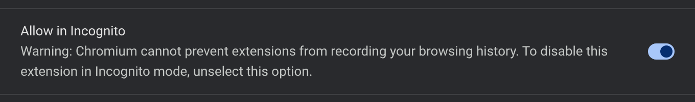
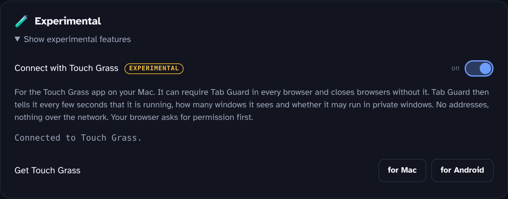

  

<h1 align="center">Connect Tab Guard with Touch Grass</h1>

  
  &nbsp;
  

<a href="touch-grass.de.md">Deutsch</a>

[Touch Grass for Mac](https://github.com/coach-kg/touchgrass-mac) can require Tab Guard in every browser. Browsers without it are closed after 10 seconds. These four steps connect the two. Do them once in every browser you use.

## 1. Add Tab Guard

| Browser | Where |
|---|---|
| Chrome, Brave, Arc, Vivaldi | [Chrome Web Store](https://chromewebstore.google.com/detail/tab-guard/imjfddpobokjecegpoghmojaondepmai) |
| Edge, Opera | [Chrome Web Store](https://chromewebstore.google.com/detail/tab-guard/imjfddpobokjecegpoghmojaondepmai). The store page shows a bar at the top: allow extensions from other stores once, then add Tab Guard. |
| Firefox, Zen | [Firefox Add-ons](https://addons.mozilla.org/en-US/firefox/addon/tab-guard/) |

Safari can't run Tab Guard. Touch Grass closes it while the browser rule is on.

## 2. Allow it in private windows

Touch Grass closes a browser if a private window could open there without Tab Guard.

**Chrome, Brave, Edge, Opera:** open `chrome://extensions` (Brave: `brave://extensions`, Edge: `edge://extensions`). Tab Guard → **Details** → turn on **Allow in Incognito**.

  

**Firefox, Zen:** when adding Tab Guard, tick **Allow this extension to run in Private Windows**. Missed it? Open `about:addons` → Tab Guard → **Run in Private Windows** → **Allow**.

## 3. Switch on the connection in Tab Guard

1. Open Tab Guard's settings. Right-click the Tab Guard icon → **Options** (Firefox: **Manage Extension** → **Preferences**).
2. At the bottom, under **Experimental**, click **Show experimental features**.
3. Turn on **Connect with Touch Grass**.
4. The browser asks for one more permission. Chrome calls it "Communicate with cooperating native applications", Firefox "Exchange messages with programs other than Firefox". Click **Allow**.

  

The line under the description shows the state:

| Status | Meaning |
|---|---|
| Connected to Touch Grass. | Done. |
| Waiting for Touch Grass. Is the app installed on this computer? | Tab Guard can't reach the app yet. See [If it doesn't connect](#if-it-doesnt-connect). |
| Off. | The switch is off, or the browser didn't get the permission. |

## 4. Turn on the rule in Touch Grass

Touch Grass → **Settings** → **Browsers** → turn on **Browsers only with Tab Guard**.

Below the switch, every browser on the Mac has a status:

| Status | Meaning |
|---|---|
| Protected | Tab Guard runs and is connected. |
| Without Tab Guard | Tab Guard is missing or not connected. **Set up** opens this page in that browser. |
| Private windows not allowed | Step 2 is missing. |
| Window without Tab Guard | A window runs without Tab Guard, for example another profile. |
| Not supported · closed | Tab Guard can't run in this browser, like Safari. |

## When Touch Grass blocks a browser

The block shows why and offers **Set up Tab Guard**. That opens this page, and the browser stays open for 3 minutes for the setup. While a schedule is active, this works once an hour.

## If it doesn't connect

- **Touch Grass is running?** It sits in the menu bar. It introduces itself to your browsers every 2 minutes and whenever its settings open. Open the settings once, then wait half a minute. Tab Guard tries again every 30 seconds.
- **Touch Grass 55 or newer?** Older versions don't know the store versions of Tab Guard. The version is at the bottom of the settings.
- **Several profiles?** Every profile needs Tab Guard and its own connection switch. Close profiles you don't use.
- **Still waiting?** Turn the switch in Tab Guard off and on again, or restart the browser.

## What Tab Guard sends

Every few seconds: a random id for the browser profile, the number of windows, whether it may run in private windows, whether it is paused, and its version. No addresses, no page titles. Native messaging only reaches a program on this computer, nothing goes over the network. Without the switch this code doesn't run: [`extension/src/touchGrass.js`](../extension/src/touchGrass.js).

---

The Chrome Web Store badge is from Google's [branding guidelines](https://developer.chrome.com/docs/webstore/branding), the "Get the add-on" badge from [Mozilla](https://extensionworkshop.com/documentation/publish/promoting-your-extension/). Both link to Tab Guard's store listings.
